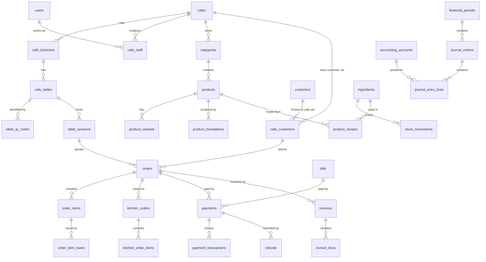

# Database Design

MySQL 8.4, shared schema. Source of truth: `backend/database/migrations/*.sql`.

Generated from the live schema: [`DATABASE_RELATIONSHIPS.md`](DATABASE_RELATIONSHIPS.md) (ER diagrams) and [`DATA_DICTIONARY.md`](DATA_DICTIONARY.md) (every column, index and trigger).

## Core ERD

The full per-domain diagrams are in `DATABASE_RELATIONSHIPS.md`. This is the backbone.



## Domains (one migration each)

| Migration | Contents |
|---|---|
| `0001_reference` | Languages, currencies, countries, translations, units, tax structure, payment reference data, chart-of-accounts templates |
| `0002_identity` | Users, customers, sessions, refresh tokens, login attempts, exchange rates |
| `0003_tenancy` | Plans, cafes, media, branches, hours, settings, themes, staff, RBAC, subscriptions, tax categories and rates |
| `0004_menu` | Categories, products, variants, add-ons, combos, schedules, branch overrides, translations |
| `0005_tables_customers` | Tables, QR, sessions, merges, cafe-customer link, favourites, wishlist, reservations, service requests |
| `0006_orders_kitchen` | Carts, orders, items, taxes, history, modifications, stations, tickets, delivery zones |
| `0007_payments_invoicing` | Gateway accounts, bills, payments, transactions, refunds, settlements, webhooks, invoices |
| `0008_inventory` | Ingredients, stock, batches, movements, recipes, suppliers, purchasing, payables |
| `0009_finance` | Accounts, periods, journal, expenses, cash registers, attendance, payroll entries |
| `0010_marketing` | Banners, coupons, promotions, loyalty, reviews |
| `0011_platform_ops` | Settings, announcements, support, audit, outbox, idempotency, notifications |
| `0012_safeguards` | Triggers: immutability, state transitions, balance, refund limits, role scope |

## Conventions

| Topic | Rule |
|---|---|
| Keys | `id BIGINT UNSIGNED`; `public_id CHAR(26)` ULID on anything exposed by an API |
| Tenant keys | `cafe_id` on all owned rows; `UNIQUE (cafe_id, id)`; composite FKs between owned rows |
| FK actions | Never `CASCADE` or `SET NULL`. Lint-enforced, so history cannot vanish indirectly |
| Money | `DECIMAL(19,4)`; unit cost `DECIMAL(19,6)`; a `currency_code` on financial records |
| Time | `DATETIME(3)`, UTC. No `TIMESTAMP`, which has a 2038 limit and session-zone conversion |
| Text | `utf8mb4_0900_ai_ci`; identifiers and hashes `ascii_bin` |
| Soft delete | `deleted_at`, with a generated `active_marker` when a unique key must allow reuse after deletion. Financial tables are not soft-deleted at all |
| Enums | Technical values are never translated. Adding a value is a migration |

## Patterns worth knowing

**"One live row" partial uniqueness.** MySQL lacks partial indexes. A generated column that is NULL when inactive, under a `UNIQUE` key, gives the same result, since NULLs do not collide: one live QR per table, one open session per table, one open cash drawer session.

**Currency pinning.** `FOREIGN KEY (cafe_id, currency_code) REFERENCES cafes (id, currency_code)` means an order cannot be in another currency, and the cafe's currency cannot change while such rows exist. Payments chain through `(cafe_id, order_id, currency_code)`.

**Branch pinning.** `FOREIGN KEY (cafe_id, branch_id, table_id) REFERENCES cafe_tables (cafe_id, branch_id, id)` keeps an order's table in the order's branch.

**Variant belongs to product.** `FOREIGN KEY (cafe_id, product_id, variant_id) REFERENCES product_variants (cafe_id, product_id, id)`.

**Cafe sees customer only via link.** `FOREIGN KEY (cafe_id, customer_id) REFERENCES cafe_customers (cafe_id, customer_id)`.

## Migration instructions

```bash
cd backend
npm run db:migrate   # applies pending migrations, verifies checksums of applied ones
npm run db:seed      # idempotent reference data
npm run db:grants    # re-run after every migration, as grants are per table
npm run db:docs      # regenerate docs
npm run db:test      # builds its own cafe_test_* databases, never touches cafe_platform
```

Never edit an applied migration: the runner refuses. Add a new numbered file. MySQL DDL is not transactional, so a failed migration can be partially applied and must be fixed forward.

To run a trigger by hand in Workbench, wrap it in `DELIMITER $$`, because the migration runner sends batches without delimiters.
