# Database Relationships

> Generated by `npm run db:docs` from the live schema. Do not edit by hand.

Diagrams show relationships inside each domain, plus the links to other domains in the table beneath. Links to the very common tables (users, languages, currencies, countries, cafes, media_assets, cafe_branches) are omitted from diagrams for legibility, but are listed.
A key shown as `cafe_id,x` is a composite tenant-safe foreign key.

## Reference

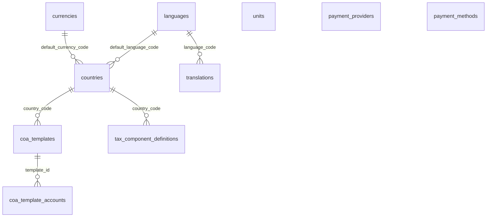

## Identity

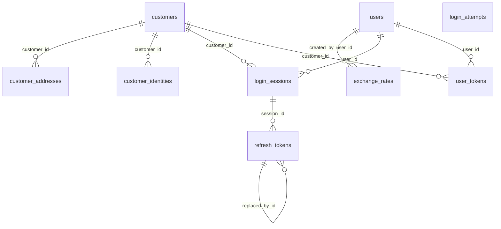

| Table | Column(s) | References |
|---|---|---|
| customer_addresses | `country_code` | countries |
| customers | `preferred_language_code` | languages |
| exchange_rates | `base_currency_code` | currencies |
| exchange_rates | `quote_currency_code` | currencies |
| login_sessions | `cafe_id` | cafes |
| users | `preferred_language_code` | languages |

## Tenancy

```mermaid
erDiagram
  cafes ||--o{ cafe_branches : "cafe_id"
  cafe_branches ||--o{ cafe_business_hours : "cafe_id,branch_id"
  cafes ||--o{ cafe_languages : "cafe_id"
  cafes ||--o{ cafe_settings : "cafe_id"
  cafes ||--o{ cafe_staff : "cafe_id"
  cafes ||--o{ cafe_subscriptions : "cafe_id"
  subscription_plans ||--o{ cafe_subscriptions : "plan_id"
  cafes ||--o{ cafe_themes : "cafe_id"
  cafes ||--o{ cafe_translations : "cafe_id"
  cafes ||--o{ cafe_usage_counters : "cafe_id"
  media_assets ||--o{ cafes : "id,logo_asset_id"
  media_assets ||--o{ cafes : "id,cover_asset_id"
  cafes ||--o{ commission_configs : "cafe_id"
  cafes ||--o{ media_assets : "cafe_id"
  subscription_plans ||--o{ plan_entitlements : "plan_id"
  subscription_plans ||--o{ plan_prices : "plan_id"
  cafes ||--o{ platform_transactions : "cafe_id"
  roles ||--o{ role_permissions : "role_id"
  permissions ||--o{ role_permissions : "permission_code"
  cafes ||--o{ roles : "cafe_id"
  cafe_subscriptions ||--o{ subscription_invoices : "cafe_id,subscription_id"
  cafes ||--o{ tax_categories : "cafe_id"
  tax_categories ||--o{ tax_rates : "cafe_id,tax_category_id"
  cafes ||--o{ tax_registrations : "cafe_id"
  cafe_branches ||--o{ tax_registrations : "cafe_id,branch_id"
  roles ||--o{ user_roles : "role_id"
  cafe_staff ||--o{ user_roles : "cafe_id,user_id"
  cafe_branches ||--o{ user_roles : "cafe_id,branch_id"
```

| Table | Column(s) | References |
|---|---|---|
| cafe_languages | `language_code` | languages |
| cafe_settings | `updated_by_user_id` | users |
| cafe_staff | `user_id` | users |
| cafe_subscriptions | `currency_code` | currencies |
| cafe_subscriptions | `provider_code` | payment_providers |
| cafe_translations | `language_code` | languages |
| cafes | `owner_user_id` | users |
| cafes | `approved_by_user_id` | users |
| cafes | `country_code` | countries |
| cafes | `currency_code` | currencies |
| cafes | `default_language_code` | languages |
| commission_configs | `created_by_user_id` | users |
| media_assets | `uploaded_by_user_id` | users |
| plan_prices | `currency_code` | currencies |
| platform_transactions | `currency_code` | currencies |
| subscription_invoices | `currency_code` | currencies |
| user_roles | `user_id` | users |
| user_roles | `granted_by_user_id` | users |

## Menu

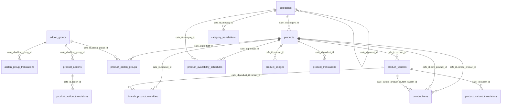

| Table | Column(s) | References |
|---|---|---|
| addon_group_translations | `language_code` | languages |
| addon_groups | `cafe_id` | cafes |
| branch_product_overrides | `cafe_id,branch_id` | cafe_branches |
| categories | `cafe_id,image_asset_id` | media_assets |
| categories | `cafe_id` | cafes |
| category_translations | `language_code` | languages |
| product_addon_translations | `language_code` | languages |
| product_images | `cafe_id,asset_id` | media_assets |
| product_translations | `language_code` | languages |
| product_variant_translations | `language_code` | languages |
| products | `cafe_id,tax_category_id` | tax_categories |

## Tables customers

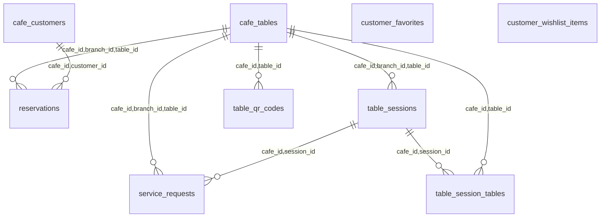

| Table | Column(s) | References |
|---|---|---|
| cafe_customers | `cafe_id` | cafes |
| cafe_customers | `customer_id` | customers |
| cafe_tables | `cafe_id,branch_id` | cafe_branches |
| customer_favorites | `customer_id` | customers |
| customer_favorites | `cafe_id` | cafes |
| customer_wishlist_items | `customer_id` | customers |
| customer_wishlist_items | `cafe_id,product_id` | products |
| reservations | `cafe_id,branch_id` | cafe_branches |
| reservations | `created_by_user_id` | users |
| service_requests | `acknowledged_by_user_id` | users |
| table_qr_codes | `revoked_by_user_id` | users |
| table_qr_codes | `created_by_user_id` | users |
| table_session_tables | `merged_by_user_id` | users |
| table_sessions | `opened_by_user_id` | users |
| table_sessions | `closed_by_user_id` | users |

## Orders kitchen

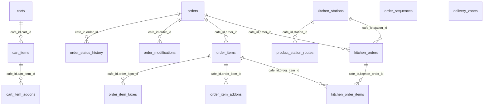

| Table | Column(s) | References |
|---|---|---|
| cart_item_addons | `cafe_id,addon_id` | product_addons |
| cart_items | `cafe_id,product_id` | products |
| cart_items | `cafe_id,product_id,variant_id` | product_variants |
| carts | `cafe_id,branch_id` | cafe_branches |
| carts | `cafe_id,session_id` | table_sessions |
| carts | `cafe_id,customer_id` | cafe_customers |
| delivery_zones | `cafe_id,branch_id` | cafe_branches |
| kitchen_orders | `cafe_id,branch_id` | cafe_branches |
| kitchen_stations | `cafe_id,branch_id` | cafe_branches |
| order_item_addons | `cafe_id,addon_id` | product_addons |
| order_items | `cafe_id,product_id` | products |
| order_items | `cafe_id,product_id,variant_id` | product_variants |
| order_items | `cafe_id,tax_category_id` | tax_categories |
| order_modifications | `modified_by_user_id` | users |
| order_modifications | `authorized_by_user_id` | users |
| order_sequences | `cafe_id,branch_id` | cafe_branches |
| order_status_history | `changed_by_user_id` | users |
| orders | `cafe_id,currency_code` | cafes |
| orders | `cafe_id,branch_id` | cafe_branches |
| orders | `cafe_id,branch_id,table_id` | cafe_tables |
| orders | `cafe_id,session_id` | table_sessions |
| orders | `cafe_id,customer_id` | cafe_customers |
| orders | `placed_by_user_id` | users |
| orders | `language_code` | languages |
| product_station_routes | `cafe_id,branch_id` | cafe_branches |
| product_station_routes | `cafe_id,product_id` | products |

## Payments invoicing

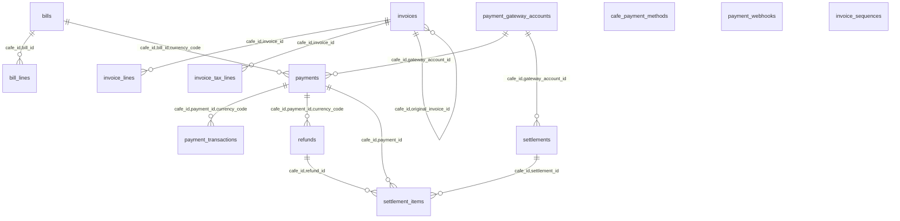

| Table | Column(s) | References |
|---|---|---|
| bill_lines | `cafe_id,order_id` | orders |
| bill_lines | `cafe_id,order_item_id` | order_items |
| bills | `cafe_id,currency_code` | cafes |
| bills | `cafe_id,branch_id` | cafe_branches |
| bills | `cafe_id,session_id` | table_sessions |
| bills | `created_by_user_id` | users |
| cafe_payment_methods | `cafe_id` | cafes |
| cafe_payment_methods | `method_code` | payment_methods |
| invoice_lines | `cafe_id,order_item_id` | order_items |
| invoice_sequences | `cafe_id,branch_id` | cafe_branches |
| invoices | `cafe_id,currency_code` | cafes |
| invoices | `cafe_id,branch_id` | cafe_branches |
| invoices | `cafe_id,order_id,currency_code` | orders |
| invoices | `cafe_id,pdf_asset_id` | media_assets |
| invoices | `language_code` | languages |
| invoices | `created_by_user_id` | users |
| payment_gateway_accounts | `cafe_id` | cafes |
| payment_gateway_accounts | `provider_code` | payment_providers |
| payment_transactions | `actor_user_id` | users |
| payment_webhooks | `cafe_id` | cafes |
| payment_webhooks | `provider_code` | payment_providers |
| payments | `cafe_id,branch_id` | cafe_branches |
| payments | `cafe_id,order_id,currency_code` | orders |
| payments | `method_code` | payment_methods |
| payments | `provider_code` | payment_providers |
| payments | `confirmed_by_user_id` | users |
| refunds | `requested_by_user_id` | users |
| refunds | `approved_by_user_id` | users |
| settlements | `currency_code` | currencies |

## Inventory

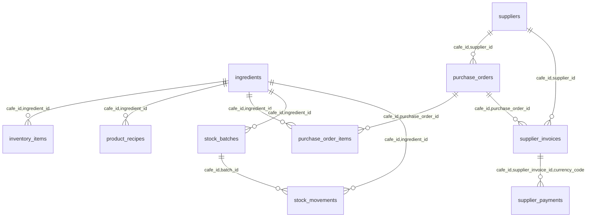

| Table | Column(s) | References |
|---|---|---|
| ingredients | `cafe_id` | cafes |
| ingredients | `unit_code` | units |
| inventory_items | `cafe_id,branch_id` | cafe_branches |
| product_recipes | `cafe_id,product_id` | products |
| product_recipes | `cafe_id,product_id,variant_id` | product_variants |
| purchase_orders | `cafe_id,branch_id` | cafe_branches |
| purchase_orders | `currency_code` | currencies |
| purchase_orders | `created_by_user_id` | users |
| stock_batches | `cafe_id,branch_id` | cafe_branches |
| stock_movements | `cafe_id,currency_code` | cafes |
| stock_movements | `cafe_id,branch_id` | cafe_branches |
| stock_movements | `created_by_user_id` | users |
| supplier_invoices | `cafe_id,document_asset_id` | media_assets |
| supplier_invoices | `currency_code` | currencies |
| supplier_payments | `method_code` | payment_methods |
| supplier_payments | `recorded_by_user_id` | users |
| suppliers | `cafe_id` | cafes |

## Finance

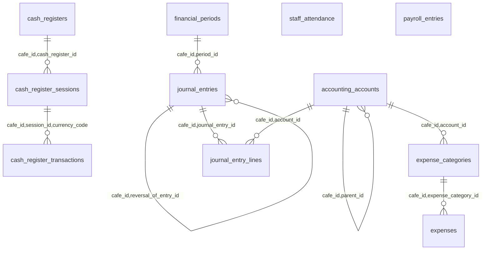

| Table | Column(s) | References |
|---|---|---|
| accounting_accounts | `cafe_id` | cafes |
| cash_register_sessions | `cafe_id,currency_code` | cafes |
| cash_register_sessions | `opened_by_user_id` | users |
| cash_register_sessions | `closed_by_user_id` | users |
| cash_register_transactions | `cafe_id,payment_id` | payments |
| cash_register_transactions | `recorded_by_user_id` | users |
| cash_registers | `cafe_id,branch_id` | cafe_branches |
| expense_categories | `cafe_id` | cafes |
| expenses | `cafe_id,currency_code` | cafes |
| expenses | `cafe_id,branch_id` | cafe_branches |
| expenses | `method_code` | payment_methods |
| expenses | `cafe_id,document_asset_id` | media_assets |
| expenses | `recorded_by_user_id` | users |
| financial_periods | `cafe_id` | cafes |
| financial_periods | `closed_by_user_id` | users |
| journal_entries | `cafe_id,currency_code` | cafes |
| journal_entries | `cafe_id,branch_id` | cafe_branches |
| journal_entries | `created_by_user_id` | users |
| payroll_entries | `cafe_id,currency_code` | cafes |
| payroll_entries | `cafe_id,staff_id` | cafe_staff |
| payroll_entries | `created_by_user_id` | users |
| staff_attendance | `cafe_id,branch_id` | cafe_branches |
| staff_attendance | `cafe_id,staff_id` | cafe_staff |

## Marketing

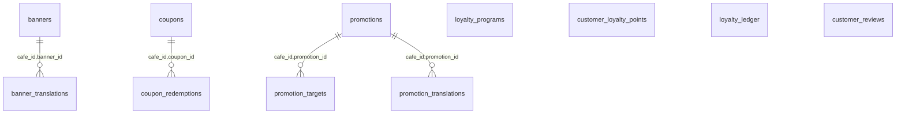

| Table | Column(s) | References |
|---|---|---|
| banner_translations | `language_code` | languages |
| banners | `cafe_id,image_asset_id` | media_assets |
| banners | `cafe_id,link_product_id` | products |
| coupon_redemptions | `cafe_id,order_id,currency_code` | orders |
| coupon_redemptions | `cafe_id,customer_id` | cafe_customers |
| coupons | `cafe_id` | cafes |
| customer_loyalty_points | `cafe_id,customer_id` | cafe_customers |
| customer_reviews | `cafe_id,order_id` | orders |
| customer_reviews | `cafe_id,customer_id` | cafe_customers |
| customer_reviews | `replied_by_user_id` | users |
| loyalty_ledger | `cafe_id,customer_id` | cafe_customers |
| loyalty_ledger | `cafe_id,order_id` | orders |
| loyalty_programs | `cafe_id` | cafes |
| promotion_targets | `cafe_id,product_id` | products |
| promotion_targets | `cafe_id,category_id` | categories |
| promotion_translations | `language_code` | languages |
| promotions | `cafe_id` | cafes |

## Platform ops

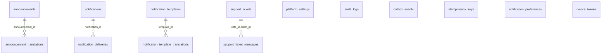

| Table | Column(s) | References |
|---|---|---|
| announcement_translations | `language_code` | languages |
| announcements | `created_by_user_id` | users |
| device_tokens | `user_id` | users |
| device_tokens | `customer_id` | customers |
| idempotency_keys | `cafe_id` | cafes |
| notification_preferences | `cafe_id` | cafes |
| notification_preferences | `cafe_id,user_id` | cafe_staff |
| notification_template_translations | `language_code` | languages |
| notifications | `cafe_id` | cafes |
| notifications | `user_id` | users |
| notifications | `customer_id` | customers |
| notifications | `language_code` | languages |
| outbox_events | `cafe_id` | cafes |
| outbox_events | `cafe_id,branch_id` | cafe_branches |
| platform_settings | `updated_by_user_id` | users |
| support_ticket_messages | `author_user_id` | users |
| support_tickets | `cafe_id` | cafes |
| support_tickets | `opened_by_user_id` | users |
| support_tickets | `assigned_to_user_id` | users |
