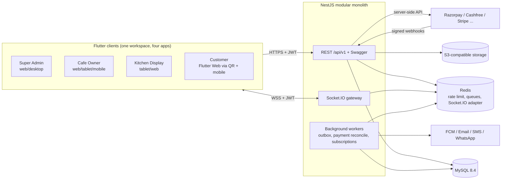
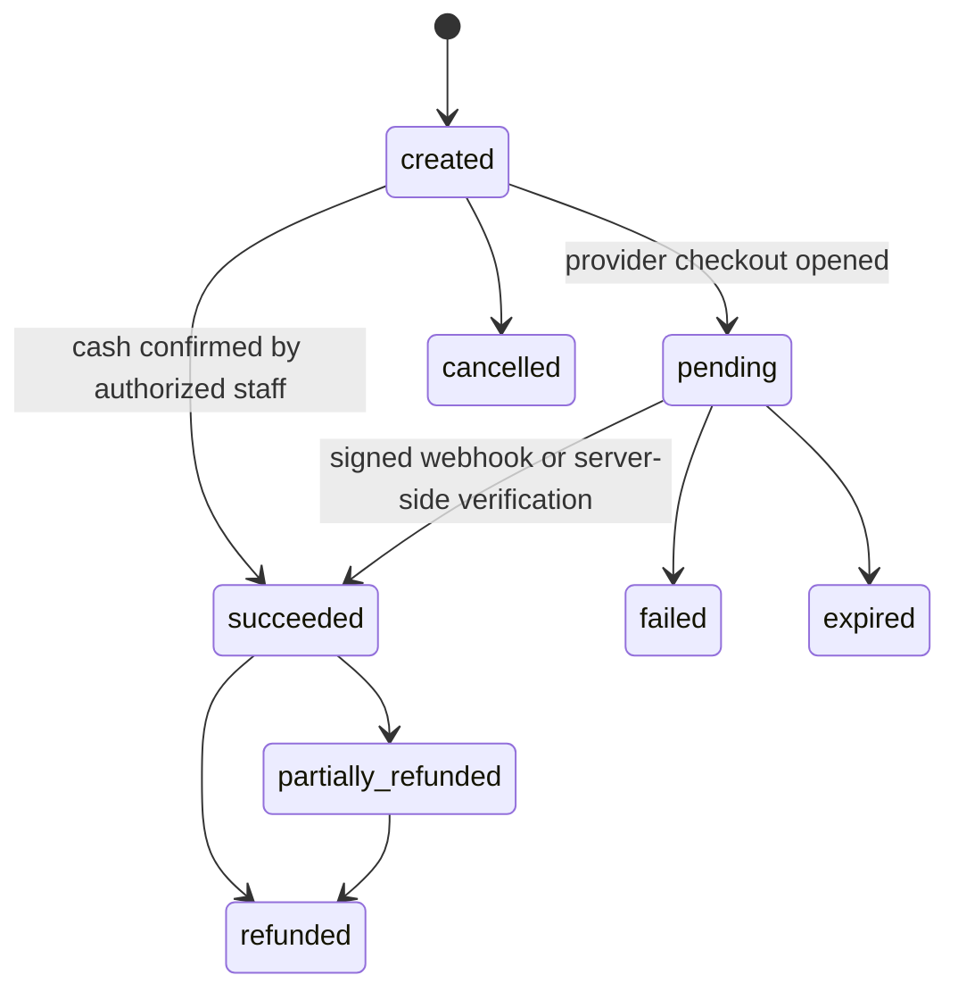

# System Architecture

Status: **implemented, subject to the open decisions in `PROJECT_REQUIREMENTS.md` §5.** One departure: background jobs are interval loops with a database lock rather than BullMQ (Rule 14: nothing needed a queue yet).

## 1. Context



The API and the workers are the same codebase and image, started with different entry points, so they can scale independently without becoming microservices.

## 2. Architecture decisions

| # | Decision | Why | Rejected alternative |
|---|---|---|---|
| ADR-1 | Modular monolith; modules talk through exported services only, never each other's tables | Mandated, and one transaction can cover order + payment + ledger | Microservices: distributed transactions around money |
| ADR-2 | Shared DB, `cafe_id` on every tenant row, **composite foreign keys `(cafe_id, x_id)`** | MySQL has no row-level security. A composite FK makes it impossible at the storage layer for a row to reference another cafe's row, even if app code has a bug | Plain FKs: cross-tenant references are silently valid |
| ADR-3 | Money is `DECIMAL(19,4)` beside a `currency_code`; unit costs `DECIMAL(19,6)`; JS `string` + decimal library, Dart `Decimal` | 4 places covers every ISO 4217 minor unit; legible in MySQL Workbench; recipe costs need sub-minor precision. Display/charge precision comes from `currencies.minor_unit` | Integer minor units: cannot represent per-gram costs and are harder to audit by hand |
| ADR-4 | Query layer: **Kysely + mysql2** with generated types; migrations are **plain versioned SQL** run by a small checksum-verifying runner | Finance needs explicit transactions and locks; SQL files open directly in Workbench; decimals remain strings | TypeORM/Prisma: float coercion risks, weak `SELECT ... FOR UPDATE` ergonomics, schema drift from generated migrations |
| ADR-5 | `BIGINT` internal PK + ULID `public_id` for externally addressable rows | Compact composite keys; no enumerable IDs in URLs | UUID PK everywhere: bloated composite indexes |
| ADR-6 | All timestamps `DATETIME(3)` in UTC. Separately stored `business_date` computed from branch timezone + day-cutoff | A cafe closing at 02:00 must report those sales on the previous trading day | Reporting by UTC date: wrong day totals |
| ADR-7 | **Order status and payment status are independent fields** | "Refunded" is not a kitchen state; an order can be served and unpaid (postpay) | One status enum: impossible states |
| ADR-8 | Orders snapshot names, prices, taxes at placement | Later menu or tax edits must not rewrite history | Joining to live products in receipts |
| ADR-9 | Financial records are append-only, enforced by DB triggers **and** DB grants | Rule 10; a bug in the app cannot erase history. Corrections are reversal entries | App-level discipline only |
| ADR-10 | Transactional outbox: domain events are written in the business transaction, then dispatched | Socket events and notifications never announce an uncommitted change. A dispatcher-assigned sequence gives reconnecting clients event recovery | Emitting directly from services: lost or phantom events |
| ADR-11 | Payment provider abstraction (`PaymentProvider` port) with per-cafe `payment_gateway_accounts`; hosted checkout only | PCI scope stays at SAQ-A: card data never touches our servers | Direct card capture |
| ADR-12 | Customers are global accounts; every cafe sees only its `cafe_customers` link | Needed for "favourite cafes" and cross-cafe history, while preventing one cafe seeing another's customer activity | Per-cafe customers: same person re-registers per cafe |
| ADR-13 | One cafe = one legal entity, one country, one currency. Tax registrations are per branch | A chain operating in two countries registers two cafes. Indian GSTIN is per state, hence per branch | Per-branch currency: multiplies all reporting complexity without a stated need |
| ADR-14 | Staff and customers are separate identity tables and JWT audiences | A leaked customer token can never be replayed against a staff endpoint | Single users table |
| ADR-15 | Dart native pub workspaces | Fewer dependencies (Rule 14) | Melos: no capability needed yet |

## 3. Backend modules

```
backend/src/
  common/          response envelope, exception filter, decimal, ids, pagination, logging
  infra/           database, redis, s3, queue, crypto, outbox dispatcher
  modules/
    identity/      users, auth, sessions, refresh rotation, RBAC, guards
    tenancy/       cafes, branches, onboarding, settings, tenant context
    branding/      themes, banners, public cafe config
    localization/  languages, translation management
    catalog/       categories, products, variants, add-ons, combos, schedules
    tables/        tables, QR, sessions, merges, transfers, reservations, service requests
    ordering/      carts, pricing engine, orders, state machine, modifications
    kitchen/       stations, tickets
    tax/           tax categories/rates/registrations, tax calculator
    payments/      provider port + adapters, webhooks, refunds, settlements, bills
    invoicing/     gapless numbering, invoices, credit notes, PDF
    inventory/     ingredients, recipes, stock, suppliers, purchasing
    accounting/    chart of accounts, periods, journal, reversals, cash registers
    finance/       expenses, payroll records, statements, exports
    customers/     customer auth, profile, addresses, favourites, wishlist
    marketing/     coupons, promotions, loyalty, reviews
    staff/         staff, attendance, activity
    notifications/ templates, preferences, device tokens, channels
    subscriptions/ plans, entitlements, usage, billing
    analytics/     cafe and platform read models
    platform/      admin, announcements, support, audit, health
    realtime/      Socket.IO gateway, rooms, replay
```

Dependency rule: `ordering` -> `catalog`, `tax`, `tables`. `payments` -> `ordering`. `accounting` consumes domain events and exposes a posting service. Cycles are a CI failure once the backend exists.

## 4. Critical flows

### QR order

```mermaid
sequenceDiagram
  participant C as Customer (browser)
  participant API
  participant DB
  participant KDS
  C->>API: GET /public/qr/{token}
  API->>DB: hash token, resolve active QR -> cafe, branch, table
  API-->>C: theme, languages, currency, table session token
  C->>API: POST /customer/orders (session token, items by ID, no prices)
  API->>DB: BEGIN; re-price from DB; tax; snapshot; order + items + kitchen tickets + outbox; COMMIT
  API-->>C: 201 order (server-computed totals)
  API-->>KDS: order.placed (from outbox dispatcher)
  KDS->>API: accept / start / ready
  API-->>C: order.status_changed
```

The tenant is always derived from the token. No client-supplied `cafe_id` or price is read.

### Payment



A database CHECK rejects `succeeded` unless the verification source is a gateway path or a staff confirmer is recorded. The legal transitions are enforced by a trigger, which also allows `failed` or `expired` to `succeeded` for a verified late gateway capture, since a provider can confirm money after we time out.

### Order status

`pending_payment -> placed -> accepted -> preparing -> ready -> served -> completed`, and `cancelled` from any state before `served` (cancellation after payment requires a refund flow).
UI mapping: "New" = `placed` with no acknowledgement; "Pending" = `pending_payment`; "Refunded" is a filter on `payment_status`.

### Sale to ledger

On a confirmed sale: order -> invoice (gapless number) -> journal entry (Dr cash/gateway clearing, Cr revenue, Cr tax payable, Dr discounts) -> stock movements by recipe -> COGS entry. Run in one transaction or via outbox with idempotency on `(source_type, source_id)`.

## 5. Realtime

- Rooms: `cafe:{id}:branch:{id}:role:{kitchen|floor|cashier|manager}`, `cafe:{id}:owner`, `session:{publicId}` (customer), `platform:admin`.
- The server computes rooms from the verified token. A client cannot name a room.
- Every event carries `{eventId, seq, type, occurredAt, payload}`. `seq` is `outbox_events.dispatch_seq`, assigned by the single dispatcher. An auto-increment id is not a safe cursor, because a lower id can commit after a higher one. On reconnect, a client sends `lastSeq`, and the server replays from `outbox_events` (retained 7 days) under the same authorization.
- Multiple instances are joined through the Redis adapter.

## 6. Non-functional targets (proposed)

| Area | Target |
|---|---|
| API p95 (non-report) | < 300 ms |
| Order-to-KDS latency | < 2 s |
| Availability | 99.9% monthly |
| RPO / RTO | 5 min (binlog PITR) / 1 h |
| QR first paint on mid-range phone over 4G | < 4 s (see risk R-1) |

## 7. Known technical risks

- **R-1 Flutter Web load time on the QR path.** The customer flow is the conversion path, and the CanvasKit/Wasm payload is heavy. Mitigation: deferred loading, a static HTML splash with cafe logo, a measured performance budget in CI. If it cannot meet budget, this must be revisited with you; Flutter is mandated, so it would not be changed silently.
- **R-2 Triggers require `log_bin_trust_function_creators=1`** on binlog-enabled servers (managed services: a parameter-group setting).
- **R-3 Report load on the primary DB.** Start with indexed aggregates and a read replica. Add summary tables if measured need appears.
